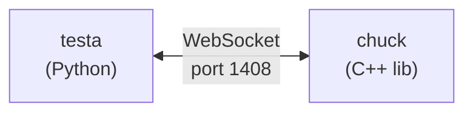

# chuck + testa

UI testing for Qt/QML apps. Chuck is a C++ library you link into your app. Testa is the Python side that talks to it.



Chuck embeds a WebSocket server in your app. Testa connects to it and drives the UI — clicking buttons, typing text, reading properties, taking screenshots. Everything goes through JSON-RPC 2.0.

## Quick start

Add chuck to your app:

```cpp
#include <chuck/ChuckServer.h>

// after your QML engine loads:
auto *window = qobject_cast<QQuickWindow*>(engine.rootObjects().first());
chuck::ChuckServer server(*window);
server.start();
```

Link it in CMake:

```cmake
find_package(Qt6 REQUIRED COMPONENTS Quick Qml WebSockets Test)
target_link_libraries(myapp PRIVATE Qt6::Quick Qt6::Qml chuck)
```

Write a test:

```python
import pytest
from testa import TestaClient

@pytest.mark.asyncio
async def test_my_app():
    async with TestaClient(port=1408) as app:
        await app.wait("mainWindow", property="visible", value=True, timeout=5000)
        await app.click("myButton")
        props = await app.get("myLabel", props="text")
        assert props["text"] == "Hello"
        await app.quit()
```

Run it (app must be running first):

```bash
uv run pytest examples/todoapp/test_todoapp.py -v
```

## What testa can do

- `click` / `keys` / `drag` / `swipe` — interact with QML items by objectName
- `get` — read any property
- `wait` — wait for items to appear or properties to change
- `find` / `tree` — search and inspect the QML tree
- `screenshot` — capture PNGs, compare against baselines (SSIM, pHash, exact)
- `quit` — close the app

## Building

Requires Qt 6, CMake, C++23.

```bash
cmake --preset <your-preset>
cmake --build --preset <your-build-preset>
```

## Documentation

```bash
uv run --group docs mkdocs serve
```

## Examples

- `examples/minimal/` — hello world
- `examples/todoapp/` — full app with StackView navigation, Material Design, and a test

## License

AGPL-3.0-only OR LicenseRef-EliasSteurerTachiom
