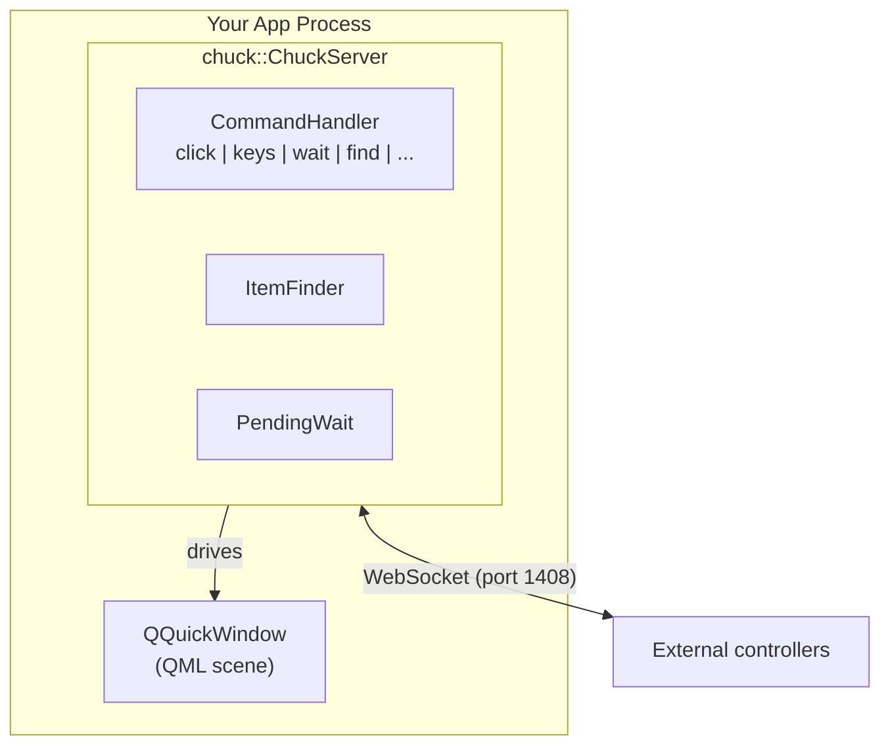

# Chuck — C++ Library

Chuck is a static C++ library that embeds a WebSocket server in your Qt/QML application. It exposes the QML object tree over JSON-RPC 2.0, allowing external controllers (testa, AI agents, or any WebSocket client) to interact with the UI.

## Architecture

## Dependencies

| Module | Required | Purpose |
|--------|----------|---------|
| `Qt6::Core` | Yes | Base types |
| `Qt6::Quick` | Yes | QQuickWindow, QQuickItem |
| `Qt6::Qml` | Yes | QML engine integration |
| `Qt6::WebSockets` | Yes | WebSocket server |
| `Qt6::Test` | Yes | QTest::mouseClick, QTest::keyClick for input simulation |

## How It Works

1. You create a `ChuckServer` and pass it your `QQuickWindow`
2. `start()` opens a WebSocket server on the configured port
3. When a client connects and sends a JSON-RPC 2.0 request, `CommandHandler` dispatches it
4. `ItemFinder` walks the QML tree to locate items by `objectName` or property query
5. Commands execute on the main thread using `QTest` input simulation
6. Results are sent back as JSON-RPC 2.0 responses
