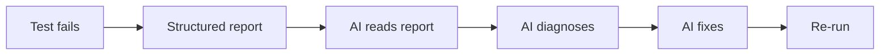

# AI Repair

When a test fails, an AI agent can diagnose and fix it using the **chuck-repair** skill. This is the "self-healing" part of chuck_tester.

## How It Works



There's no magic LLM API call embedded in the code. The intelligence lives in a **Copilot skill** (`.github/skills/chuck-repair/SKILL.md`) that teaches any AI agent how to diagnose and fix test failures. The Python side just produces structured failure context.

## Generating a Failure Report

```bash
uv run chuck repair session.jsonl --port 1408
```

On failure, this produces:

1. **`session.report.json`** — structured step results, error codes, messages
2. **`repair_screenshot.png`** — screenshot of the app at the failure point
3. **Tree dump** — the full QML tree at the moment of failure (embedded in the report)

## Repair Workflow

### 1. Capture

```bash
uv run chuck repair session.jsonl
```

### 2. Diagnose

The AI reads the report and applies the diagnosis decision tree:

| Error Code | First Action |
|---|---|
| `-32001` ItemNotFound | Dump tree, check if objectName was renamed or item hasn't loaded |
| `-32002` ItemNotVisible | Check StackView page, wait for visibility |
| `-32003` ItemDisabled | Wait for enabled state |
| `-32004` BlockedByModal | Dismiss the modal |
| `-32006` Timeout | Check expected value with `get()`, fix the expectation |

### 3. Fix

The AI edits the test file (or QML source) with the minimal change needed. Common fixes:

- **Add a `wait()` before the failing step** — most common fix for timing issues
- **Update an objectName** — if it was renamed in the QML
- **Add navigation** — if the test needs to be on a different page
- **Update assertion values** — if the expected behavior changed

### 4. Verify

```bash
uv run pytest test_myapp.py -v
```

## Skill-Based Architecture

Traditional test repair tools embed an LLM: they call an API, format a prompt, parse the response, apply the patch. This creates:

- Provider lock-in (OpenAI? Anthropic? Local?)
- Complex prompt management code
- Brittle response parsing

Chuck_tester takes a different approach: the repair logic is a **Copilot skill** — a markdown document that teaches the AI agent how to diagnose failures. The agent already has all the tools it needs (file editing, terminal, MCP).

**Benefits:**

- Works with any AI that reads skills (Copilot, Claude, etc.)
- One source of truth (the SKILL.md)
- No API calls, no prompt templates, no response parsing
- The AI reasons freely using the decision tree
- Easy to update — just edit a markdown file

## CI Integration

```yaml
# GitHub Actions example
- name: Run tests
  run: uv run chuck replay session.jsonl --fail-on-diff

- name: Upload failure artifacts
  if: failure()
  uses: actions/upload-artifact@v4
  with:
    name: test-failure
    path: |
      session.report.json
      repair_screenshot.png
```

When tests fail in CI, the report artifacts give the AI agent (or a human) everything needed to diagnose the issue.
