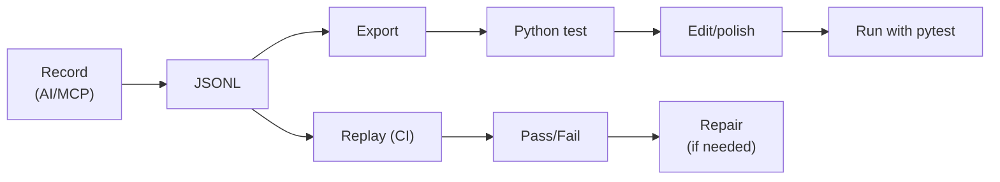

# Recording & Replay

Testa can record every interaction as JSONL (JSON Lines) and replay it later for regression testing.

## JSONL Format

One JSON object per line. Each line has an `action` and relevant parameters:

```jsonl
{"ts": "2026-04-10T14:32:00.000Z", "action": "wait", "item": "mainWindow", "property": "visible", "value": true, "timeout": 10000}
{"ts": "2026-04-10T14:32:01.500Z", "action": "click", "item": "createProjectBtn"}
{"ts": "2026-04-10T14:32:02.300Z", "action": "keys", "item": "nameField", "text": "My Project"}
{"ts": "2026-04-10T14:32:03.000Z", "action": "screenshot", "tag": "project_created", "verify": true}
{"ts": "2026-04-10T14:32:04.000Z", "action": "quit"}
```

### Fields

| Field | Required | Description |
|-------|----------|-------------|
| `action` | Yes | Command name: `click`, `keys`, `wait`, `screenshot`, `quit`, etc. |
| `item` | Depends | Target objectName |
| `ts` | No | ISO 8601 timestamp (recorded automatically, ignored during replay) |
| `tag` | No | Label for screenshots |
| `verify` | No | If `true`, compare screenshot against baseline |
| Other | — | Command-specific params (same as the JSON-RPC params) |

## Recording

### During MCP Sessions

```bash
uv run testa mcp --port 1408 --record session.jsonl
```

Every AI tool call is automatically logged.

### Programmatic Recording

```python
from testa import TestaClient
from testa.recorder import Recorder

async with TestaClient(port=1408) as app:
    rec = Recorder("session.jsonl")
    rec.start()

    await rec.click(app, "addBtn")
    await rec.keys(app, "nameField", text="Hello")
    await rec.screenshot(app, tag="after_add")

    rec.stop()
```

## Replay

```bash
# Basic replay
uv run testa replay session.jsonl

# With visual verification
uv run testa replay session.jsonl --fail-on-diff

# Custom port
uv run testa replay session.jsonl --port 9223
```

Output:

```
Replaying 10 steps from session.jsonl
  [1/10] wait ✓
  [2/10] click ✓
  [3/10] keys ✓
  [4/10] screenshot (project_created) ✓ (score: 0.9812)
  ...
  [10/10] quit ✓

Replay PASSED
```

### Failure Reporting

On failure, testa writes `session.report.json`:

```json
{
  "session": "session.jsonl",
  "total_steps": 10,
  "passed": false,
  "failed_step": 5,
  "steps": [
    {"step": 1, "action": "wait", "status": "ok"},
    {"step": 2, "action": "click", "item": "addBtn", "status": "ok"},
    ...
    {"step": 5, "action": "click", "item": "saveBtn", "status": "fail",
     "error_code": -32001, "error_message": "Item not found: saveBtn"}
  ],
  "tree_dump": [...],
  "screenshot": "repair_screenshot.png"
}
```

## Export to Python

Convert a JSONL session to a pytest test file:

```bash
uv run testa export session.jsonl --to-python test_flow.py
```

Generated output:

```python
# Auto-generated from session.jsonl
import pytest
from testa import TestaClient

@pytest.mark.asyncio
async def test_session():
    async with TestaClient(port=1408) as app:
        await app.wait('mainWindow', property='visible', value=True, timeout=10000)
        await app.click('createProjectBtn')
        await app.keys('nameField', text='My Project')
        await app.screenshot(save_to='screenshots/project_created.png')
        await app.quit()
```

The generated script is a starting point — add assertions, helpers, and comments to make it a real test.

## Workflow


