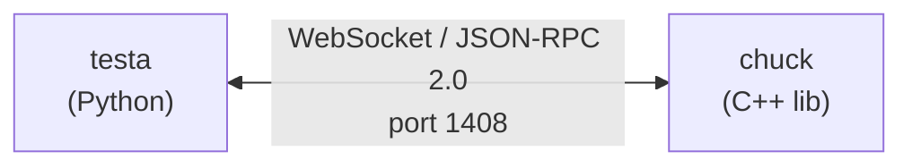
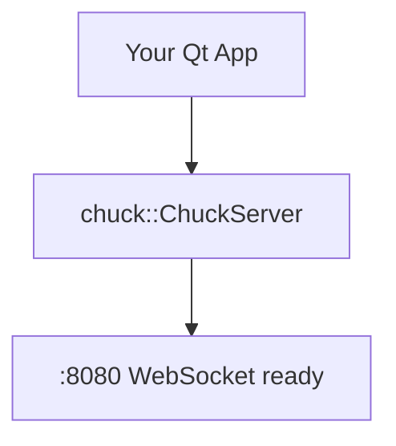
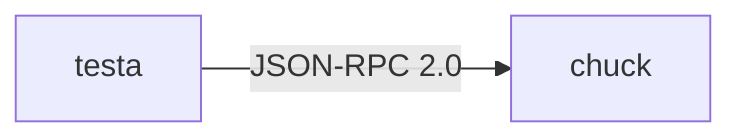
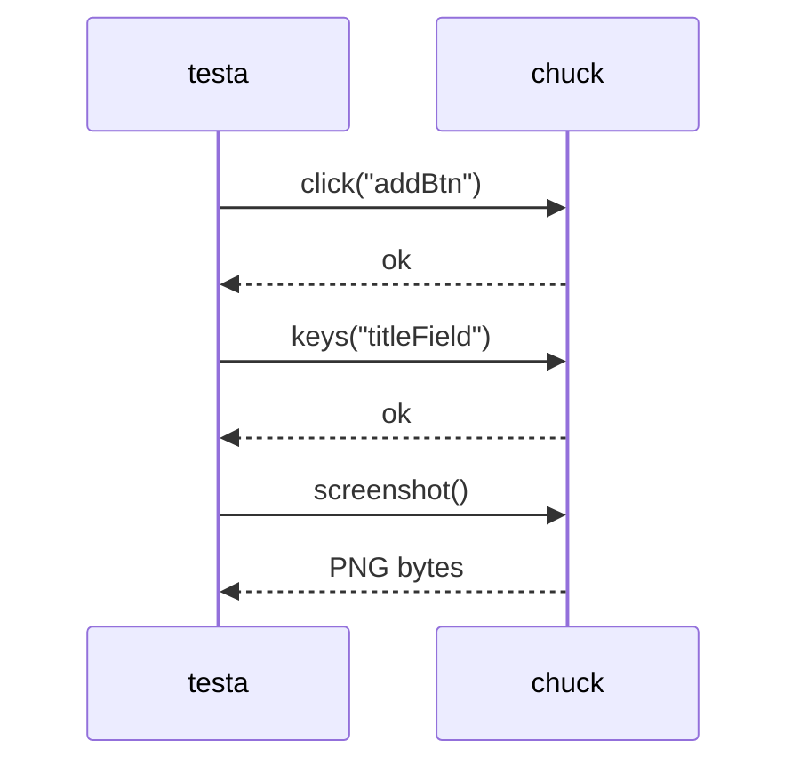
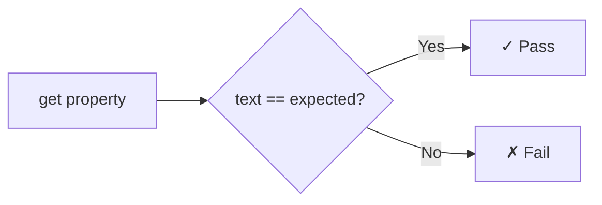
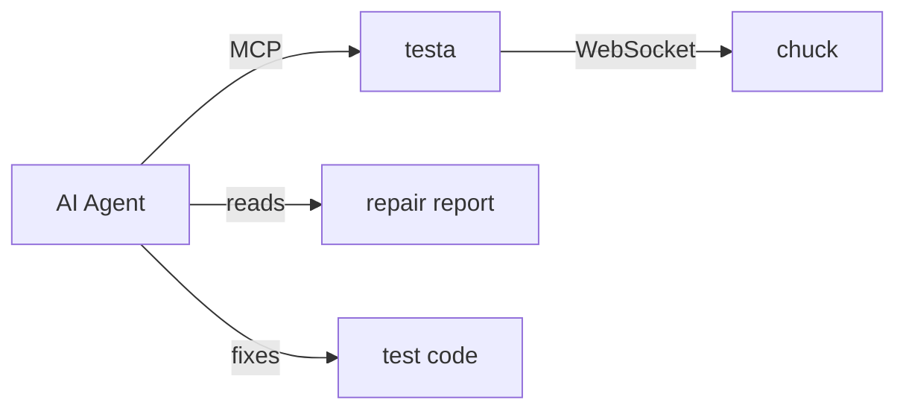
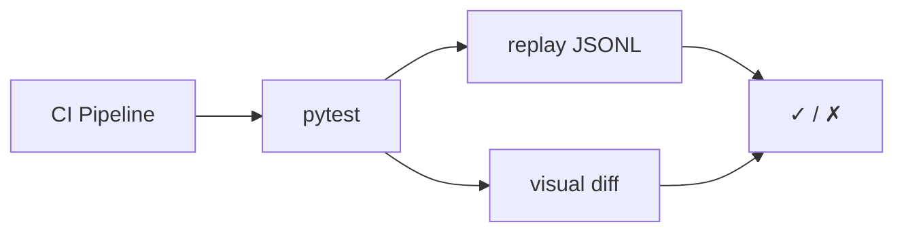

<div style="text-align: center; margin: 2rem 0;">
  
</div>

Chuck is a C++ library you link into your app. Testa is the Python controller that drives it. Together they let you — or an AI — test Qt/QML interfaces over a simple WebSocket connection.



## Why?

- **No injection or hooking** — chuck is linked as a normal library, not injected at runtime
- **AI-first** — tests can be written by hand, generated by AI, or driven live through MCP
- **JSON-RPC 2.0** — standard protocol, debuggable with any WebSocket tool
- **Pytest native** — tests are regular async Python, run with `pytest`
- **Visual regression** — screenshot baselines with SSIM, perceptual hash, and diff images
- **Self-healing** — when tests break, an AI agent can diagnose and repair them using the testa-repair skill

## How It Works

<div class="step" markdown>
<div class="step-text" markdown>

### :material-numeric-1-circle: Link chuck into your app

Add three lines of C++ after your QML engine loads. Chuck embeds a WebSocket server right inside your process.

```cpp
chuck::ChuckServer server(*window);
server.start();
```

</div>
<div class="step-visual" markdown>



</div>
</div>

<div class="step" markdown>
<div class="step-text" markdown>

### :material-numeric-2-circle: Connect with testa

Testa opens a WebSocket to your app on port 1408 and speaks JSON-RPC 2.0.

```python
async with TestaClient(port=1408) as app:
```

</div>
<div class="step-visual" markdown>



</div>
</div>

<div class="step" markdown>
<div class="step-text" markdown>

### :material-numeric-3-circle: Drive the UI

Click buttons, type text, read properties, take screenshots — all by `objectName`.

```python
await app.click("addBtn")
await app.keys("titleField", text="Buy milk")
await app.screenshot()
```

</div>
<div class="step-visual" markdown>



</div>
</div>

<div class="step" markdown>
<div class="step-text" markdown>

### :material-numeric-4-circle: Assert & verify

Check properties, wait for state changes, compare screenshots against baselines.

```python
props = await app.get("label_0", props="text")
assert props["text"] == "Buy milk"
```

</div>
<div class="step-visual" markdown>



</div>
</div>

<div class="step" markdown>
<div class="step-text" markdown>

### :material-numeric-5-circle: Let AI help

An AI agent can explore the app via MCP, generate tests from recordings, and repair failures automatically.

```bash
uv run testa mcp --port 1408
uv run testa repair session.jsonl
```

</div>
<div class="step-visual" markdown>



</div>
</div>

<div class="step" markdown>
<div class="step-text" markdown>

### :material-numeric-6-circle: Run in CI

Tests are regular pytest. Record sessions as JSONL, replay in CI, catch visual regressions.

```bash
uv run pytest tests/ -v
```

</div>
<div class="step-visual" markdown>



</div>
</div>

## At a Glance

```python
from testa import TestaClient

async with TestaClient(port=1408) as app:
    await app.wait("mainWindow", property="visible", value=True)
    await app.click("createBtn")
    await app.keys("nameField", text="My Project")
    props = await app.get("nameField", props="text")
    assert props["text"] == "My Project"
    await app.quit()
```

## What's in the Box

| Component | Language | What it does |
|-----------|----------|--------------|
| **chuck** | C++ | Embeds a WebSocket server in the app, walks the QML tree, executes click/type/screenshot/wait commands |
| **testa** | Python | Connects to chuck, provides async API + CLI + MCP server + JSONL recording |
| **skills** | Markdown | Copilot/AI skills for writing tests ([testa-testing](guide/writing-tests.md)) and repairing them ([testa-repair](guide/ai-repair.md)) |

## Next Steps

<div class="grid cards" markdown>

- :material-rocket-launch: **[Getting Started](getting-started.md)** — add chuck to your app in 5 minutes
- :material-language-cpp: **[Chuck API](chuck/api.md)** — C++ public header reference
- :material-language-python: **[Testa API](testa/api.md)** — Python client reference
- :material-test-tube: **[Writing Tests](guide/writing-tests.md)** — patterns, synchronization, assertions
- :material-image-check: **[Visual Testing](guide/visual-testing.md)** — screenshot baselines and comparison
- :material-robot: **[MCP Server](testa/mcp.md)** — let an AI drive your app

</div>
